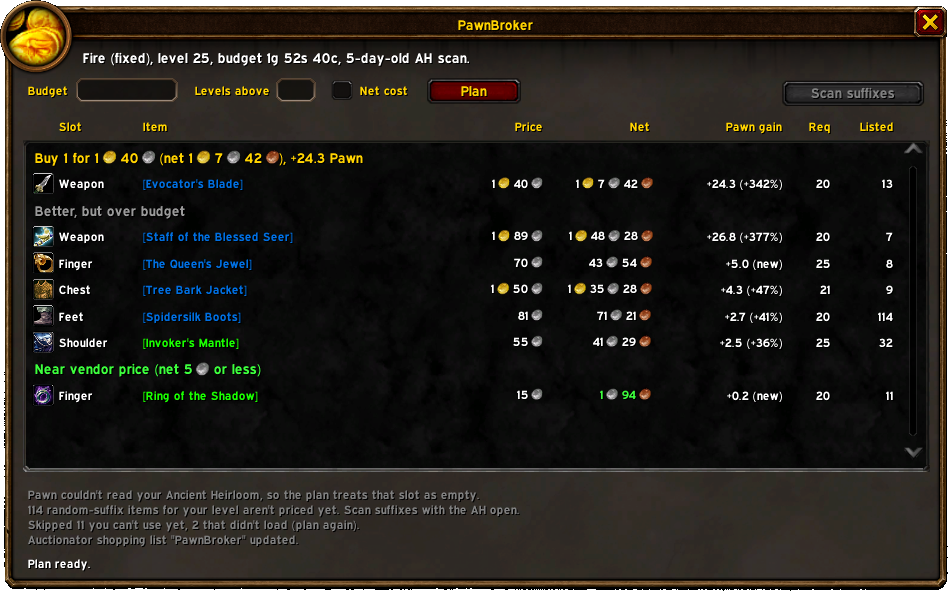
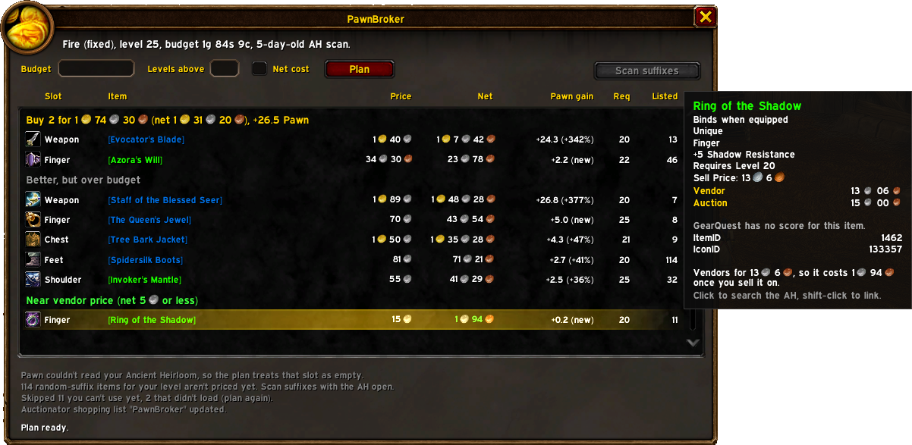
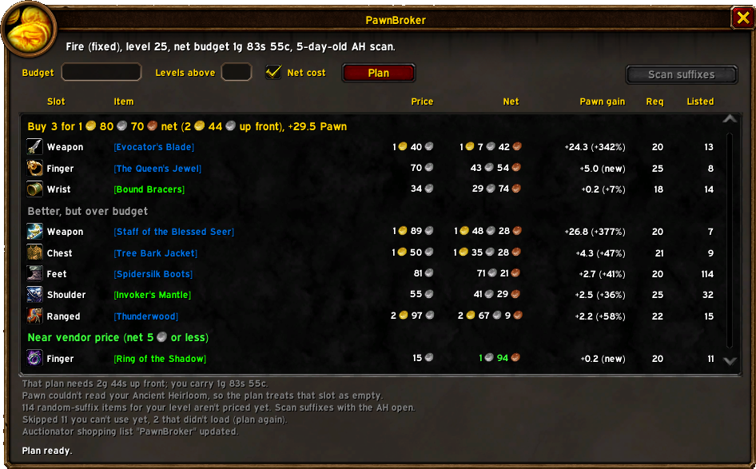

# PawnBroker

Find the gear upgrades worth buying on the auction house, scored by Pawn and priced by Auctionator.
For World of Warcraft: Forever.



- Plans the upgrades that add the most Pawn score for the gold you have, at most one per slot
- Shows each item's net cost: its AH price minus what a vendor pays for it
- Lists upgrades that a vendor buys back for nearly what they cost
- Plans by net cost when you'd rather count what you get back
- Prices each version of random-suffix items, like "of the Owl", separately

PawnBroker isn't made by or affiliated with the authors of Pawn or Auctionator.
It needs both and uses their data.

## Getting started

You need [Pawn](https://www.curseforge.com/wow/addons/pawn) with one scale shown, and [Auctionator](https://www.curseforge.com/wow/addons/auctionator).
Install PawnBroker with your addon manager, or unzip a release so the `PawnBroker` folder ends up in `World of Warcraft\_forever_\Interface\AddOns`.

Run a full Auctionator scan at the AH, then type `/pb` anywhere.
Scan again every few days to keep the prices current.

## Commands

| Command | What it does |
|---|---|
| `/pb` | Plan with the gold you carry |
| `/pb 1g50s` | Plan with a budget of 1g 50s |
| `/pb all` | Plan with no budget: the best item for each slot |
| `/pb +2` | Include items up to 2 levels above you |
| `/pb net` | Plan by net cost instead of AH price |
| `/pb near 10s` | Count a net cost of 10s or less as near vendor price (the default is 5s) |
| `/pb near off` | Hide the near vendor price list |
| `/pb scan` | Price random-suffix items (needs the AH open) |
| `/pb stop` | Stop a suffix scan |

Options combine, for example `/pb 1g net +1`.

## The window

The window lists:

- Buy: the upgrades to get, at most one per slot, within your budget
- Better, but over budget: stronger items you can't afford yet
- Near vendor price: upgrades that a vendor buys back for nearly what they cost

Each row shows the item's AH price, its net cost, the Pawn gain over what you're wearing, the level it needs and how many are listed.
Hover a row for the item's tooltip, click it to search the AH, or shift-click to link it in chat.
Each plan also fills the Auctionator shopping list "PawnBroker" with the items to buy.

The budget is the gold you carry unless you type one in, such as `1g50s`, or `all` for no limit.
The Levels above box adds items you can't wear yet, so you can plan a few levels ahead.

## Net cost and near vendor price

An item's net cost is its AH price minus what a vendor pays for it.
That's what it costs you if you sell it once you outgrow it.
The Net column shows it for every row, and hovering a row shows the vendor price.

Upgrades with a net cost of 5s or less get their own list, Near vendor price.
They cost next to nothing once you sell them on, which makes them cheap stopgaps, and their net cost shows in green.
`/pb near 10s` changes the limit and `/pb near off` hides the list.



Tick the Net cost box, or type `/pb net`, to plan by net cost instead of AH price.
The budget then caps what the plan costs you after selling everything on, so it can include an item that's over budget at AH price but sells back for most of it.
The plan's title gives both totals, and a note says when the items cost more up front than the gold you carry.



## Random-suffix items

Auctionator keeps one price per item, the cheapest version, so it can't tell "Willow Vest of the Owl" from "Willow Vest of the Monkey".
With the AH open, Scan suffixes looks up every random-suffix item from 10 levels below you to 5 above and saves the cheapest listing of each version for your realm.
Plans then price each version separately.
The window asks for a new scan when the last one is over a day old or you've gained 3 levels since.

## How it plans

PawnBroker only considers items your class can wear, at or below your level (or as many levels above it as you asked for), whose tooltips have no red text such as a profession requirement.
It compares rings and trinkets with the weaker of the two you wear, and a two-hander with your main hand and off hand together.
It skips off hands while you wear a two-hander and ignores gains under 0.5%, as Pawn does.

From what's left it picks at most one item per slot, with the most total Pawn gain that fits the budget.

## Privacy and safety

PawnBroker only reads and plans.
It never sends chat or addon messages, so nothing leaves your game.
It doesn't hook or replace any Blizzard code, secure frames or key bindings, and it never buys or posts anything on the AH.
It writes to two places:

- `PawnBrokerDB`, its saved variables: the window settings, the last plan, each character's last suffix scan, and the suffix price cache, which drops entries after 7 days
- the Auctionator shopping list named "PawnBroker", which each plan replaces

Scan suffixes only runs when you start it.
It sends one AH search at a time and waits for the AH's throttle between them.

## Limits

- A plan buys at most one ring, one trinket and one hand-held item. Plan again after equipping to fill the second ring or trinket slot.
- It doesn't check unique-equipped items or weapon skills, beyond what turns tooltip text red.
- Prices are only as fresh as your last Auctionator scan.

## Reporting issues

[Open an issue](https://github.com/stackrot/PawnBroker/issues/new?template=bug_report.yml) and the form asks for what's needed.
That's the versions of PawnBroker, Pawn, Auctionator and the game, and any Lua error.
Most problems come from a Pawn, Auctionator or game update, so the versions matter.
Type `/console scriptErrors 1` in game to see errors, or use BugSack to copy them.

## Development

The tests run the addon against mocked game, Pawn and Auctionator APIs with real scan data.
They need [LuaJIT](https://luajit.org) and run the same on Windows, macOS and Linux:

```
luajit tests/run.lua       # all scenarios
luajit tests/run.lua -v    # with chat output
```

CI runs them on Ubuntu and Windows for every push.
Pushing a version tag such as `v0.1.1` runs the tests again, then the [BigWigs packager](https://github.com/BigWigsMods/packager) builds the release from `.pkgmeta` and posts it to GitHub and CurseForge.
The package leaves out the tests, the docs and this README.
The mockups and the 400×400 avatar for addon sites come from `docs/mockups/`, and the comment at the top of each file says how to render it.

## AI use

Written with AI assistance (Claude), then reviewed and tested by me before each release.

## Licence

MIT
